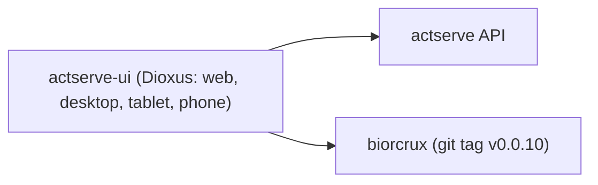

# actserve-ui

Administration interface of [actserve](../actserve): servers, domains and DNS, WireGuard, orchestrations and workflows, ecosystem presets. A Dioxus app, one crate for web, desktop, tablet and phone.

> **Status (2026-11-26):** builds against [`biorcrux`](https://github.com/grosjeanbaptiste/biorcrux) v0.0.10 by git tag and Dioxus `main`. Where this page says `bioxus`, read `biorcrux`.

| Run | Command |
|---|---|
| Web | `make web` |
| Desktop | `make desktop` |
| iOS / Android | `dx serve --platform ios` / `android` (`--no-default-features --features mobile`) |
| All gates | `make ci-local` |

The layout follows the screen: bottom bar on phones, rail on tablets, sidebar on desktops (`bioxus::widgets::AppShell`). Pick blocks with the features `store`, `store-sqlite`, `sync`; nothing is imposed.

Icon: `assets/icon.png` is the BIOXUS icon. Replace it with your own and every platform follows (`build.rs` checks it is a valid PNG). For iOS, build the set with bioxus `scripts/make-ios-set.sh assets/icon.png stores/ios/AppIcon.appiconset`.

## Contents

- [How it works](#how-it-works)

## How it works

